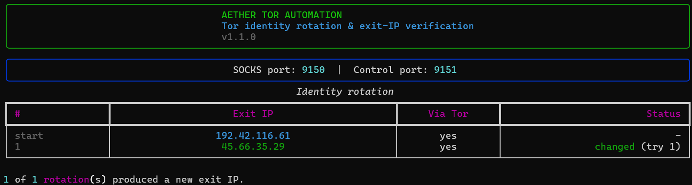

# 🛡️ AETHER-Tor-Automation

> **Tor identity rotation & exit-IP verification from the command line**

AETHER asks a local Tor instance for a new identity through the **Tor control port** (`NEWNYM`) and then verifies the result against the Tor Project's own check endpoint, so you can see whether the exit IP really changed and whether your traffic is really leaving through Tor. It is aimed at security researchers and OSINT analysts who need to rotate exits during authorized testing.


## 🚀 Features

* **Real rotation, real verification:** sends `NEWNYM`, then checks the exit through `check.torproject.org` and reports both the IP and whether Tor is actually in use (`IsTor`). If that site is unreachable from the current exit, it retries and falls back to `api.ipify.org` and `httpbin.org`; those can show the IP but cannot confirm Tor usage, so the "Via Tor" column shows `?`.
* **Respects Tor's rate limit:** consecutive rotations wait out Tor's ~10 second `NEWNYM` interval instead of sleeping a fixed, arbitrary time.
* **Automatic retries:** if Tor happens to pick the same exit again, AETHER retries (`--attempts`) and tells you honestly when the IP did not change.
* **Port auto-detection:** tries Tor Browser (`9151`/`9150`) and the Tor system service (`9051`/`9050`) as matched pairs, or take ports explicitly with `--control-port` / `--socks-port`.
* **DNS through Tor:** requests use `socks5h://`, so hostnames are resolved by Tor rather than your local resolver.
* **Reusable core:** the Tor logic lives in `rotator.py` with no UI code, so you can import it from your own scripts.
* **Rich terminal UI:** result table and status spinners via [`rich`](https://github.com/Textualize/rich).

## 📸 Screenshots



## 📋 Prerequisites

* Python 3.9+
* A running Tor instance: either **Tor Browser** (just keep it open) or the **Tor service**.

For the Tor service, enable the control port in `torrc` (usually `/etc/tor/torrc`) and restart Tor:

```
ControlPort 9051
CookieAuthentication 1
```

On Debian/Kali, the cookie file is only readable by the `debian-tor` group:

```bash
sudo usermod -aG debian-tor $USER   # log out and back in afterwards
```

Prefer password authentication instead? Generate a hash with `tor --hash-password "yourpassword"`, put it in `torrc` as `HashedControlPassword ...`, and pass the password with `--ask-password` or the `TOR_CONTROL_PASSWORD` environment variable.

## 🛠️ Installation & Usage

```bash
git clone https://github.com/Kadirveysel/AETHER-Tor-Automation.git
cd AETHER-Tor-Automation
pip install -r requirements.txt
python main.py
```

Common options:

```bash
python main.py                       # one rotation, auto-detected ports
python main.py -n 5                  # five rotations in a row
python main.py -n 5 -i 30            # wait an extra 30 s between rotations
python main.py -a 5                  # retry up to 5 times if the exit stays the same
python main.py --control-port 9051 --socks-port 9050 --ask-password
python main.py --help                # all options
```

The exit code is `0` when every rotation produced a new IP, `1` when at least one did not (or an error occurred), which makes it easy to use in scripts.

### Use it as a library

```python
from rotator import TorRotator

rotator = TorRotator()                  # or TorRotator(control_port=9051, socks_port=9050)
result = rotator.rotate_ip(max_attempts=3)
print(result.previous.ip, "->", result.current.ip, "changed:", result.changed)
```

## ⚙️ How it works

1. AETHER connects to the control port, authenticates, and sends `SIGNAL NEWNYM`. Tor then builds new circuits for **new** connections.
2. It makes a fresh HTTPS request through the SOCKS proxy (`Connection: close`, new session each time, so no pooled connection can hide the change) to `https://check.torproject.org/api/ip`.
3. It compares the reported IP with the previous one and repeats up to `--attempts` times if they match.

## ⚠️ Limitations

* A new identity affects **new connections only**. Connections that are already open keep their old circuit.
* Tor chooses exits itself; getting the same exit twice is normal and not an error.
* This tool changes your Tor circuit. It does not make other software anonymous: browser fingerprinting, logged-in accounts and application-level leaks are outside its scope.
* Some exit nodes block or break TLS to certain sites (you may see `SSLEOFError`). AETHER retries and uses fallback services, but if every IP-check site fails through a given exit, just run it again to get a different exit.

## 🧪 Development

```bash
pip install -r requirements-dev.txt
ruff check .
pytest
```

The tests mock the Tor control port and the network, so no Tor instance is needed.

## 🩺 Troubleshooting

| Message | Likely cause and fix |
| --- | --- |
| `Tor ports not found` | Tor Browser/service is not running, or it uses non-default ports. Pass `--control-port` and `--socks-port`. |
| `Authentication ... failed` | Cookie file not readable (join the `debian-tor` group) or a password is required (`--ask-password`). |
| `Could not connect to the control port` | `ControlPort` is not enabled in `torrc`, or Tor was not restarted after editing it. |
| `No IP-check endpoint answered ...` | Tor has not finished bootstrapping, the current exit blocks the check sites (just run again), or the SOCKS port is wrong. The message lists the error for each endpoint. |
| `Warning: ... NOT exiting through Tor` | The SOCKS port you are using is not Tor's. |

## ⚠️ Disclaimer

This tool is created for **educational purposes** and authorized security research only. The author is not responsible for any misuse or damage caused by this program. Always obtain permission before testing network defenses.

## 📄 License

MIT. See [LICENSE](LICENSE).

Authored by **Kadir Veysel Sayar** (aka Plansmight), [@Kadirveysel](https://github.com/Kadirveysel)
